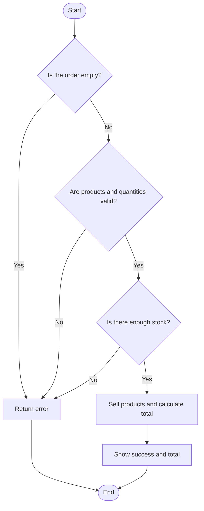

Pseudocode

Names: Jad Abou Ibrahim and Ahmad Taha  
Function: `process_order(order_list)`

1. If the order is empty, show an error.
2. Check the product IDs and quantities.
3. If any product or quantity is invalid, show an error.
4. Check that there is enough stock.
5. If there is enough stock, sell the products.
6. Show the total price.

Flowchart

Names: Jad Abou Ibrahim and Ahmad Taha  
Function: `process_order(order_list)`

